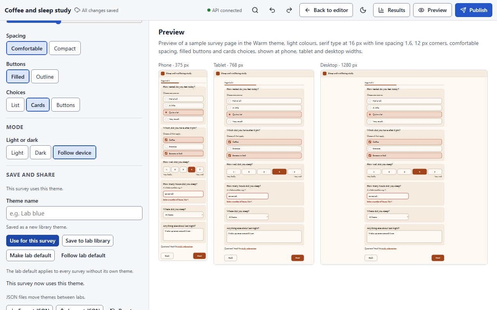

# Appearance

**Appearance** in the top bar opens the survey's theme: how it looks to participants.
Themes are built from a small set of design tokens, previewed live, and checked for
contrast before you can publish.

<figure markdown="span">
  { loading=lazy }
</figure>

## Start from a preset

**Clean**, **Warm**, **High contrast**, **Dark** and **Compact**. A preset fills in every
token; you then adjust what you like.

## What you can change

| Section | Controls |
|---|---|
| **Brand** | **Accent** and **Background**; under *More colours*, **Cards and panels**, **Text**, **Hints and borders**, **Error messages** and **Focus ring**; **Header text**. A logo upload is coming. |
| **Type** | **Font** (Sans, Serif, Rounded), **Base size** (16 to 32 px) and **Line spacing** (1 to 2.5). |
| **Shape and density** | **Corner radius**, **Spacing** (Comfortable or Compact), **Buttons** (Filled or Outline) and **Choices** (Cards or Buttons). |
| **Mode** | **Light or dark**: Light, Dark or *Follow device*. In *Follow device* you edit the light and the dark palette separately (**Colours for**). |

The **Preview** panel shows a sample page in phone, tablet and desktop frames as you edit.
Undo and redo work here too.

## The contrast check

Every colour pair is checked against WCAG AA, and the base size against a 16 px minimum.
The banner at the top reads *Ready to publish. Every colour pair meets WCAG AA contrast.* or
*Can't publish: N contrast problems*, with a link to each problem; a failing colour field
offers the **Nearest passing colour**. Publishing is blocked until the theme passes.

## Save and share

- **Use for this survey** applies the theme you are editing to this survey.
- **Save to lab library** stores it under a **Theme name** so other surveys in the lab can
  use it; **Lab library** loads a saved theme. **Make lab default** and **Follow lab
  default** set and use the lab-wide default. Only owners and editors can change the
  library.
- **Export JSON** and **Import JSON** move a theme between labs or installations;
  **Reset** returns to the preset.

The lab's theme library has its own page (**Appearance** from the surveys list, or the
`themes` page in a host), with the same editor and no survey attached.

## What participants see

The participant app applies the theme on every screen size, in light or dark mode as chosen
(or as the device prefers), and sets the browser's toolbar colour to the theme's page
background. Hosts can replace the app's icon with their own
([Hosting](hosting.md#the-participant-apps-icon)).
