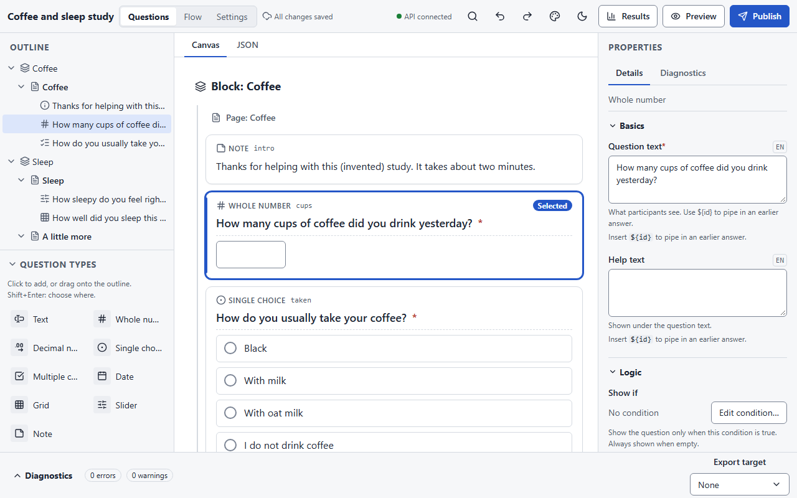
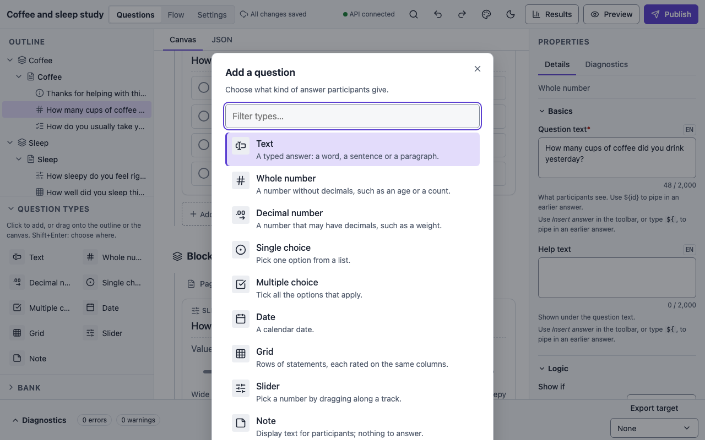

# Building a survey

The builder is where a researcher designs a survey: its pages and questions, their logic,
and how it looks. This page covers the editor itself. [Question types](question-types.md),
[Logic and flow](logic.md), [Settings](settings.md), [Appearance](appearance.md) and
[Publishing](publishing.md) cover the rest.

## Create a survey

Open the builder (in `make dev`, <http://localhost:5173>). The **Your surveys** page lists
the lab's surveys, newest first. Type a title under **New survey title** and press
**Create survey**; if you belong to more than one lab, choose the **Lab** first. The editor
opens on the new survey, which starts with one block, one page and a note.

## Import a survey

Surveys built elsewhere can be brought in from the same page. Under the create form, press
**Import from Qualtrics, LimeSurvey or SurveyJS…** and choose a file:

| Platform | File | How to get it |
|---|---|---|
| Qualtrics | `.qsf` | Survey → Tools → Import/Export → Export Survey |
| LimeSurvey | `.lss` | Survey → Display/Export → Survey structure (.lss) |
| SurveyJS | `.json` | The survey JSON from the Creator's JSON editor |

The file is read in your browser and sent to the server for a **preview** before anything
is created. The preview says how the file was read, lets you change the **Title**, and
lists:

- **What will be created**: questions by type, pages and blocks, languages, conditions,
  variables and quotas.
- **What will not carry over**: every feature the file uses that has no counterpart here,
  each named with the source feature (a question type, an attribute, a flow element) and
  the reason. Nothing is dropped silently.
- **What will behave differently**: features that were imported but run differently here,
  for example a soft-mandatory LimeSurvey question (optional here) or a Qualtrics
  "request response" (optional here).
- **Notes**: things that carried over with a change of shape, such as a hidden field that
  became a URL-parameter variable, or HTML formatting removed from labels.

**Import** creates the draft and opens it in the editor; the usual diagnostics then apply
(for example a missing translation in one language). The mapping, format by format:

| From | To |
|---|---|
| Qualtrics blocks and page breaks; LimeSurvey groups; SurveyJS pages | blocks and pages |
| Single and multiple choice, text, number, date, descriptive text | the matching question types |
| Qualtrics Likert grids, LimeSurvey arrays, SurveyJS matrices | grids (rows × columns) |
| Qualtrics sliders; SurveyJS sliders; LimeSurvey number ranges written by this platform | sliders |
| Display logic, relevance equations, `visibleIf` | **Show if** conditions |
| Branches, block randomisers, end-of-survey elements; LimeSurvey randomisation groups | the flow |
| Embedded data; hidden LimeSurvey fields with a default | URL-parameter variables |
| Equations, calculated values | computed variables, where the expression can be expressed |
| LimeSurvey quotas on answer codes | quotas with a check after the question's page |
| Rank order, constant sum, file upload, signature, heat maps, hot spots, drill-downs, dual-scale and text arrays, "Other" text boxes, custom validation, loop & merge, triggers, scoring | reported as not carried over |

A file exported **from** this platform as `.lss` imports back with its question ids,
types, choices, bounds, assignments and conditions. The exporter's random-draw helpers are
replaced by this platform's own randomisation (noted in the preview); its end-outcome
helper, if any, comes back as a computed variable you can delete.

## The editor

<figure markdown="span">
  { loading=lazy }
  <figcaption>Outline on the left, the questions in the middle, properties on the right.</figcaption>
</figure>

The editor has three panes:

- **Outline** (left): the survey as a tree of blocks, pages and questions, and under it
  the **Question types** toolbox.
- **Canvas** (middle): every question, drawn as participants will see it, under its page
  and block headers. Each card shows the question's type, its id, an asterisk if it is
  required, and badges for its logic ("Show if …", "Shuffled choices", "Validation …") and
  for problems ("2 errors", "1 warning"). Clicking a badge takes you to the property
  concerned. A **JSON** tab shows the whole survey as text and lets you edit it directly.
- **Properties** (right): the selected item's fields, grouped as Basics, Choices, Logic,
  Validation and Advanced, with a **Diagnostics** tab listing its problems.

The top bar has the survey title, the view tabs (**Questions**, **Flow**, **Settings**), the
save status, and the actions: **Command palette**, **Undo**, **Redo**, **Appearance**, the
light/dark toggle for the builder itself, **Results**, **Preview** and **Publish**. On
narrower screens the less-used actions move into a **More actions** menu.

### Saving

There is no Save button. Every edit is sent to the server as an *op* as soon as you make it,
and the status in the top bar says **Saving…** and then **All changes saved**. If the
connection drops the status reads *Offline: changes will be sent when you reconnect* and
your edits queue up on the page. If someone else changed the survey in the meantime the
status reads *Conflict: changed elsewhere* and offers **Reload**.

## Pages, blocks and questions

A survey is made of **blocks**, each holding **pages**, each holding **items** (questions
and notes). Participants see one page at a time; blocks are what the [flow](logic.md#flow)
orders, branches and randomises. A block's title is for you only and is never shown to
participants.

Select anything by clicking it in the outline or on the canvas. The outline is fully
keyboard-operable: ++up++ / ++down++ move, ++left++ / ++right++ collapse and expand,
++enter++ selects, ++shift+up++ / ++shift+down++ extend the selection.

### Adding a question

Three ways:

1. **Add question** on a page (on the canvas) opens the **Add a question** picker. Type to
   filter the nine types, then click one. The picker marks the type you used last.
2. Click a type in the **Question types** toolbox under the outline to add it to the
   selected page. Drag a type onto the outline to choose exactly where it goes, or press
   ++shift+enter++ on a type to pick the page and position from a dialog.
3. From the command palette: **Add question…**, or **Add text question**, **Add grid
   question** and so on.

<figure markdown="span">
  { loading=lazy }
</figure>

Then fill in **Question text** in the properties panel. Use **Insert answer** in the
field's toolbar (or type `${`) to [pipe in](logic.md#piping) an earlier answer: it
appears as a chip you can move or delete as one character.

### Formatting text

Every participant-facing text can carry formatting: **bold**, *italic*, links, line
breaks, bulleted and numbered lists and, in notes, the consent text and ending text,
headings. Click into a text field in the properties panel (or Tab to it) and a toolbar
appears above it: Bold (++ctrl+b++), Italic (++ctrl+i++), Link (`https://` addresses
only, opened in a new tab), lists, a line break (++shift+enter++), Insert
answer, Clear formatting, Undo and Redo, and in notes and other long texts a *Text style*
select for headings. ++alt+f10++ moves to the toolbar and ++esc++ back to the text;
++tab++ always leaves the field. Your edit is saved after a short pause or when you leave
the field; ++esc++ throws away what you typed since the last save. A count under the
field shows how much of the field's limit you have used.

Pasting from Word, Google Docs or a web page keeps the formatting the survey can hold and
drops the rest (colours, fonts, images, tables become their text, underline, nested
lists); a line under the field says what was simplified. Underline is never offered: on the
web it reads as a link.

Choice and matrix row labels, and the translations of a text, are still edited as plain
text in their own dialogs (tasks RT5 and RT6). The JSON view shows and accepts the stored
form:

A plain string stays a plain string. A formatted value is `{"type": "rich", "blocks":
[...]}`, where each block is a paragraph `{"type": "p", "content": [...]}`, a heading
`{"type": "h", "level": 1–3, "content": [...]}` (shown under the page title) or a list
`{"type": "ul" | "ol", "items": [[...], [...]]}`. Content is a list of runs: `{"text":
"...", "marks": ["b", "i"], "href": "https://...", "lang": "fr"}` (every key but `text`
optional), `{"pipe": "id"}` for a piped answer (the same ids and built-ins as `${id}`), and
`{"br": true}` for a line break. Per language, each value is plain or formatted on its own.

The rules, checked on every save:

| Where | Allowed | Characters |
|---|---|---|
| Notes, the survey description, the consent text, end messages, ending bodies | headings, paragraphs, lists, marks, links, pipes, breaks | 20,000 |
| Question text and help | paragraphs, lists, marks, links, pipes, breaks (no headings) | 2,000 |
| Choice, row and column labels, slider end labels, page titles, constraint messages, consent buttons, ending titles | one paragraph with marks, links, pipes, breaks | 500 |
| The survey title | plain text only | – |

Links must be absolute `https:` URLs; they open in a new tab, with a hidden "(opens in a new
tab)" for screen readers. Nothing else can be stored: no colours, fonts, sizes, images or
raw HTML (`text.block_not_allowed`, `link.scheme`, `link.empty`, `text.too_long`). A
formatted value that uses no formatting at all is saved as the plain string it is.

### Moving things

Drag an item by its handle in the outline, or use the keyboard: ++alt+up++ /
++alt+down++ move past a sibling, ++alt+shift+up++ / ++alt+shift+down++ cross a page or
block boundary. **Move to…** (in the palette) offers a dialog with **At the start**,
**After …** or **At the end**. Pages and blocks move the same way. ++esc++ cancels a drag.

### Changing a question's type

Under the properties form, **Change type…** switches the type while keeping the text, help,
variable name and display conditions. If something would be lost (the choices of a single
choice question becoming a slider, say) the builder asks first.

### Ids and variable names

Every item has a stable **id**, shown on its card. Conditions and piping refer to the id,
so it never changes. The **Variable name** (Advanced) is the column name in exports; it
defaults to the id and can be renamed freely. Names must be unique ignoring case, because
SPSS, Stata and LimeSurvey fold case.

## Undo and redo

Every edit can be undone and redone, with ++ctrl+z++ and ++ctrl+shift+z++ (or ++ctrl+y++),
the top-bar buttons or the palette. The history is per page load.

## The command palette

++ctrl+k++ (++cmd+k++ on a Mac) opens the palette. It reaches every command: adding
questions, **Change question type…**, **Move to…**, **Open survey flow**, **Add flow
node**, **Open survey settings**, **Open Appearance**, **Preview survey**, **Publish
survey**, **Open results**, the pane toggles and the theme. ++f6++ and ++shift+f6++ move
focus between panes.

## Diagnostics

The survey is validated as you edit. The **Diagnostics** strip at the bottom of the editor
counts errors, warnings and export issues; open it to see each one with where it is, and
click one to jump to the property. The **Export target** select there (None, XLSForm,
LimeSurvey) also shows which features that target cannot carry, as "Unsupported in
LimeSurvey" or "Approximated in XLSForm" badges on the cards and headers
([Publishing and exports](publishing.md#exporting-the-survey-itself)).

Errors block publishing; warnings do not. Typical warnings: a missing translation, a
condition that is also true for someone who did not answer, a reference into the other arm
of a branch.

## The JSON view

The **JSON** tab on the canvas shows the full survey document (`osp-survey/0.1`), which you
can edit and **Apply**. The server validates it like any other edit, and refuses anything
that would break the survey. This is also where things the visual editor has no control for
yet can be done, such as adding a block or deleting a page.

!!! tip "Preview as you go"
    **Preview** in the top bar runs the draft in phone, tablet and desktop frames with a
    debugger alongside; nothing is saved. See [Publishing](publishing.md#before-you-publish-preview).
