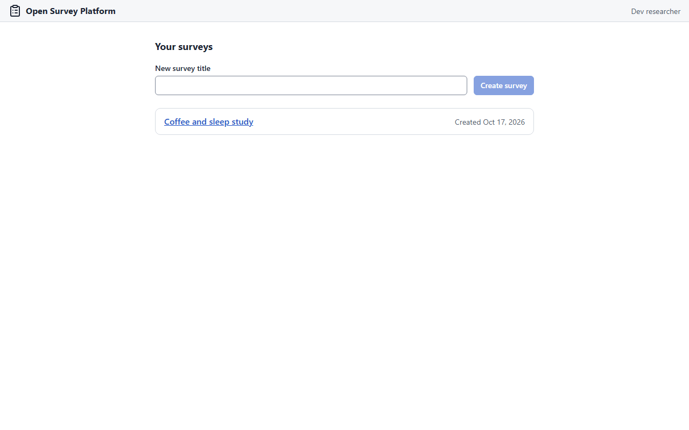

# Getting started

This page gets the platform running on a laptop: the API, the builder and the participant
app, with three seeded surveys and no sign-in. For a real deployment behind your
institution's login, see [Hosting](hosting.md).

## Prerequisites

- [uv](https://docs.astral.sh/uv/) (Python 3.14 is fetched by uv itself)
- Node 22 or newer and [pnpm](https://pnpm.io/)
- GNU make and a POSIX shell (on Windows, Git Bash plus `make` from Chocolatey)

## Install and run

```sh
git clone https://github.com/andytwoods/open-survey-platform.git
cd open-survey-platform
make install   # uv sync + pnpm install, from the lockfiles
make dev       # API + builder + participant app; Ctrl+C stops them all
```

The first `make dev` creates everything it needs in `.data/` (ignored by git): a SQLite
database, dev-only encryption keys, and three published surveys from the fixture set:
"All question types", "Block randomiser" and "Multi-language". There is no sign-in in dev:
everyone is the dev researcher, owner of the dev lab. Every run prints something like:

```text
  Builder      http://localhost:5173
  API health   http://localhost:8000/api/health
  API docs     http://localhost:8000/api/docs

  No sign-in: everyone is dev-researcher, owner of dev-lab (dev only)

  Seeded surveys
    All question types  (01-all-types)
      builder      http://localhost:5173/surveys/<id>
      participant  http://localhost:5174/r/?s=<slug>
    ...
```

## What to click

1. Open <http://localhost:5173>. The list shows your surveys; create one with a title, or
   open a seeded one.

    <figure markdown="span">
      { loading=lazy }
    </figure>

2. Open a survey. Add a question, rename things, and try undo and redo. Every edit is
   saved to the API as you go; the top bar says "All changes saved" when it has caught up.
3. Open a **participant** link in another window (a private window works well) and answer
   the survey as a participant. The block-randomiser survey shuffles the order of its blocks
   per participant; the multi-language one has its text in more than one language.

From here, [Building a survey](building-a-survey.md) walks through the builder, and
[Publishing and exports](publishing.md) covers getting a survey in front of participants
and the data back out.

## Resetting, ports and options

- `make dev-reset` wipes `.data/`, so the next `make dev` starts fresh.
- Ports 8000 (API), 5173 (builder) and 5174 (participant app) must be free. Override them:

    ```sh
    make dev DEV_API_PORT=8010 DEV_BUILDER_PORT=5183 DEV_RUNTIME_PORT=5184
    ```

- The API on its own runs with `uv run osp-api serve`. With `OSP_ENV=production` it refuses
  to generate keys and needs `OSP_STORE_KEYS` and `OSP_DATABASE_URL` set
  ([Hosting](hosting.md), section 1).

!!! warning "Dev only"
    `make dev` makes everyone the lab owner and generates its own keys. Never point it at
    real data, and never use `OSP_IDENTITY=dev` on a server. The API refuses that
    combination unless it is bound to the loopback address with `OSP_ENV=dev`.

## Checks

`make check` runs every test, lint, layer, licence and docs check; it must be green before a
change lands. GitHub Actions runs the same checks on every push and pull request. See
[Contributing](reference/contributing.md).
