---
hide:
  - navigation
description: >-
  An open-source, GUI-first survey builder for research: a visual editor, survey logic,
  several languages, validated instruments, results charts, preregistration and
  reproducibility exports, and self-hosting behind your own sign-in.
---

# Open Survey Platform

**An open-source, GUI-first survey builder for research.** Design a study in the browser,
run it on any screen size, and keep everything you need to show exactly what each
participant saw.

[Get started](getting-started.md){ .md-button .md-button--primary }
[See it in action](demos.md){ .md-button }

<figure markdown="span">
  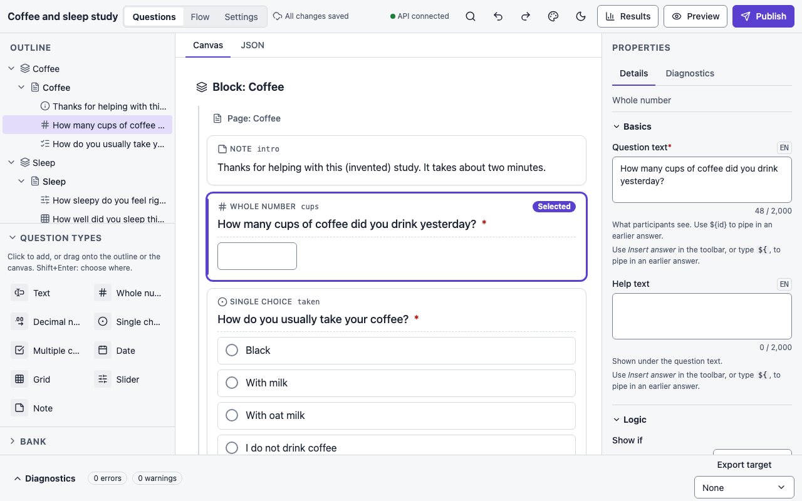{ width="1280" height="800" }
  <figcaption>The builder, editing an invented "Coffee and sleep study". Every screenshot on this site uses made-up data.</figcaption>
</figure>

!!! note "Status: early development"
    Usable on a laptop for building and running test surveys (October 2026); not yet
    deployed in production. Expect breaking changes. The source is on
    [GitHub](https://github.com/andytwoods/open-survey-platform) under the MIT licence.

## Build surveys visually

**Point, click and type: no code and no markup to learn.**

- Three panes: an **outline** of blocks, pages and questions, a **canvas** that draws each
  question as participants will see it, and a **properties** panel.
- **Nine question types**: text, whole number, decimal number, single choice, multiple
  choice, date, grid (matrix), slider and note. Add one from a picker, click it in the
  toolbox, or drag it onto the outline; change a question's type later without losing its
  text or logic.
- A **rich-text editor** for every participant-facing text: bold, italic, links, lists and
  headings, with earlier answers piped in as chips. Pasting from Word keeps what a survey
  can hold.
- Saves as you go, with undo and redo, a command palette (++ctrl+k++ / ++cmd+k++) and full
  keyboard operation.

[Read more: building a survey](building-a-survey.md) ·
[question types](question-types.md)

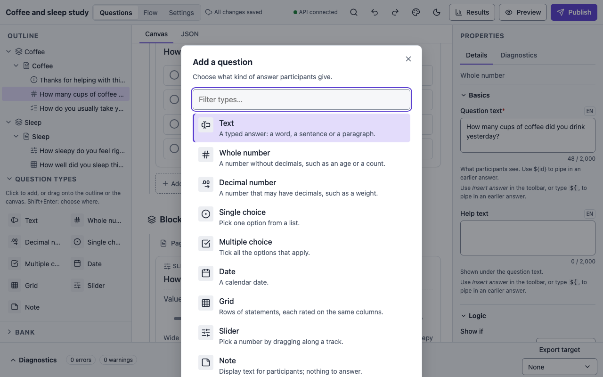{ loading=lazy width="1280" height="800" }

## Logic and flow

**Show the right questions to the right people, in a reproducible order.**

- **Show if** conditions on questions and pages, built from rows or typed as a small,
  documented expression language.
- A **flow** of blocks with **branches**, **randomisers** (show N of M blocks in a random
  order), random **assignment** to conditions, **quotas** and **End** nodes with named
  outcomes such as `screened_out`.
- **Piping**: `${cups}` repeats an earlier answer in any label, help text or note.
- Every random decision is seeded and recorded with the response, so it can be recomputed.

[Read more: logic and flow](logic.md)

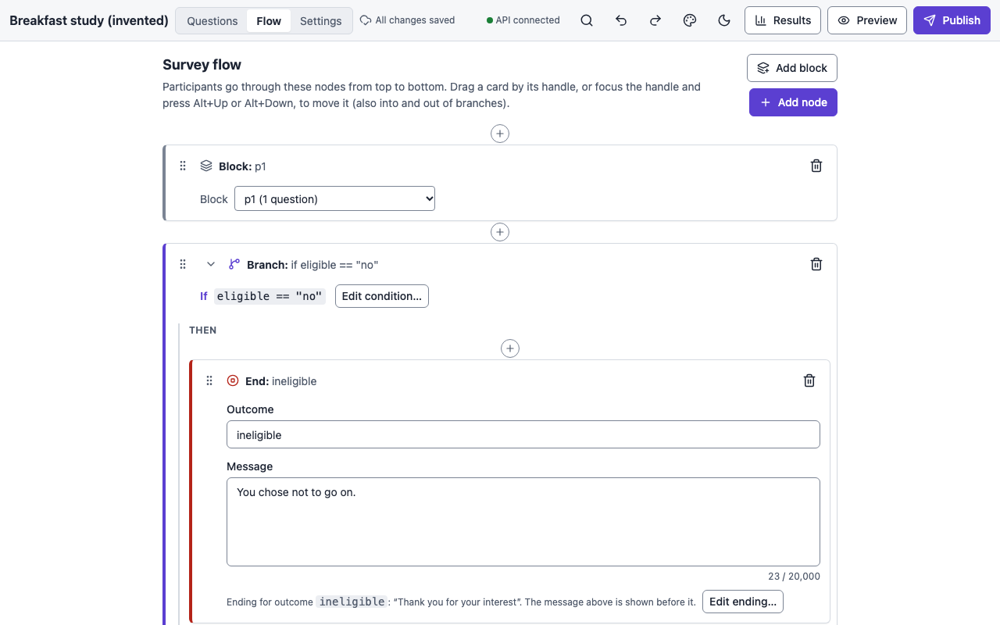{ loading=lazy width="1280" height="800" }

## Languages and appearance

**One survey in several languages, in a theme that passes contrast checks.**

- Add languages by tag (`de`, `pt-BR`) and edit **one language at a time**: each field shows
  the default-language text as a reference, with **Copy from** and a **Missing
  translation** flag. Participants get the language their browser prefers.
- Themes from five presets (Clean, Warm, High contrast, Dark, Compact) and a small set of
  design tokens: colours, font, size, corners, spacing, light or dark.
- Every colour pair is checked against **WCAG AA** before you can publish; a failing colour
  offers the nearest passing one.
- Save themes to a lab library and share them as JSON.

[Read more: languages](settings.md#languages) · [appearance](appearance.md)

=== "Translating"

    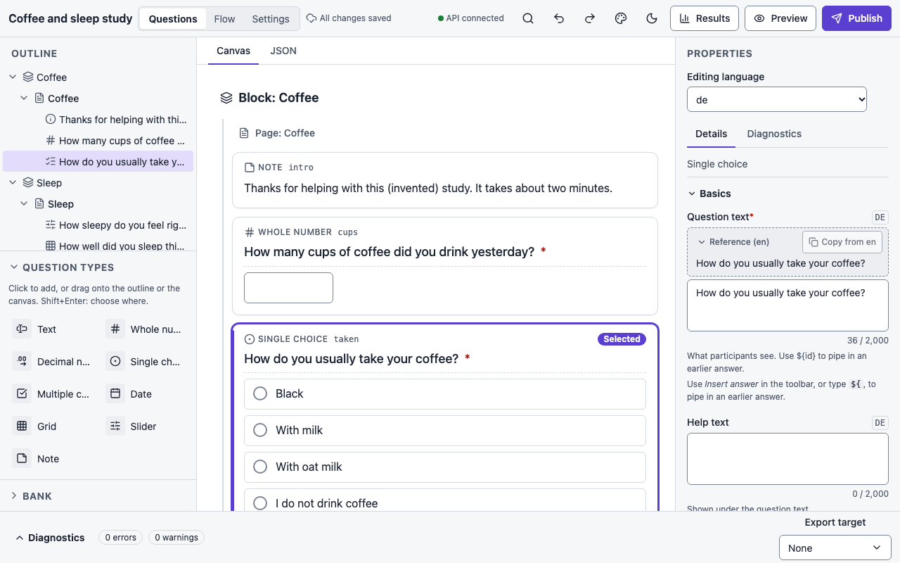{ loading=lazy width="1280" height="800" }

=== "Themes"

    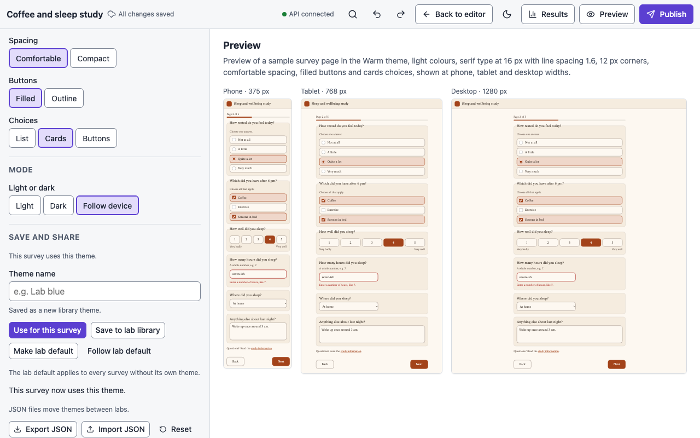{ loading=lazy width="1280" height="800" }

## A question bank with validated instruments

**Reuse questions, pages and blocks, and drop in standard scales with their scoring.**

- Bundled instruments whose text may be redistributed: **PHQ-9, PHQ-2, GAD-7, GAD-2,
  Mini-IPIP, NASA-TLX**, the CDC ACE module and a CC0 demographics set, inserted whole with
  their scoring variables.
- Save your lab's own questions, pages and blocks, with versions; share them with other
  labs on the same server.
- For licensed instruments (BDI-II, PSS-10 and others) the platform ships the citation,
  response format and scoring recipe; a lab that holds a licence adds its own copy,
  privately.
- Inserted items remember where they came from, so the codebook lists the instruments a
  survey used.

[Read more: the question bank](question-bank.md)

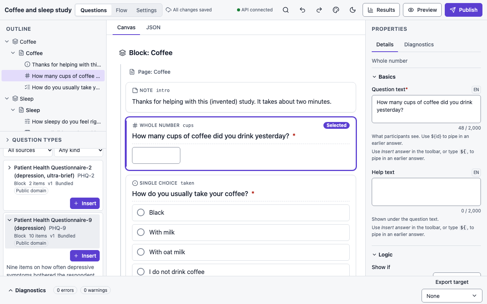{ loading=lazy width="1280" height="800" }

## Endings, redirects and recruitment panels

**A different ending for each outcome, and a safe hand-off to Prolific or an experiment.**

- An **ending per outcome**: completers, screened-out and quota-full participants each get
  their own title and text, with piped answers.
- **Redirects** after the survey, for example back to Prolific with a **completion code
  per outcome**, after a countdown or by a button. Destinations are declared templates, and
  every value is checked before the browser goes anywhere.
- Capture `PROLIFIC_PID` and other URL parameters as variables.
- **External tasks** mid-survey: send participants to a jsPsych, PsychoJS or Gorilla
  experiment and bring them back with a signed, expiring return token.

[Read more: endings](settings.md#endings) · [redirects](settings.md#redirects) ·
[external tasks](logic.md#external-task-step)

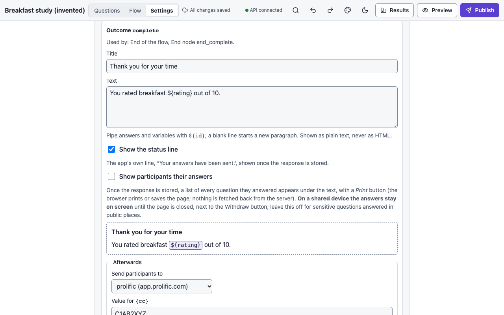{ loading=lazy width="1280" height="800" }

## Results you can show and publish

**A chart and a table per question, from the first response.**

- One card per question with response states, statistics and a chart chosen for its type
  (bars, histograms, box plots, diverging bars for grids, and more), plus an accessible
  table view.
- **Filters** by version, date, condition and answers; **split** by a question or
  condition; 95 % intervals; **saved layouts**.
- **Live** updates as responses arrive, and a **presentation mode** for a lab screen that
  hides counts below 5 by default.
- Export any card as **SVG, PNG** (at journal column widths and 150 to 600 DPI) or **CSV**,
  or every card at once as a ZIP.

[Read more: results](results.md)

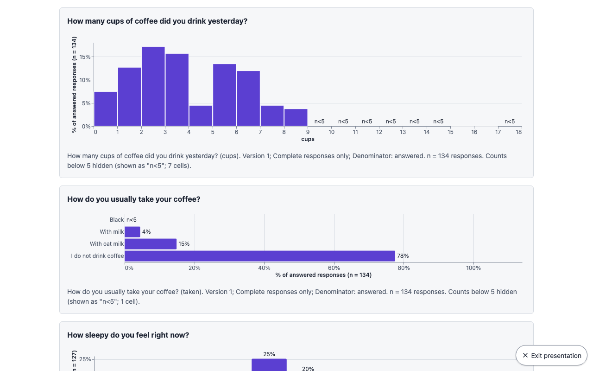{ loading=lazy width="1280" height="800" }

## Import and export

**Bring surveys in from other tools, and take them out again.**

- **Import** Qualtrics (`.qsf`), LimeSurvey (`.lss`) and SurveyJS (JSON) files. A preview
  lists what will be created, what will not carry over and what will behave differently,
  before anything is saved. Nothing is dropped silently.
- **Export** the survey to **XLSForm** (ODK, Enketo, KoboToolbox) and **LimeSurvey**, each
  with a capability table that says, feature by feature, what the target can carry.
- Responses as **CSV or JSON** with a codebook; every missing answer is labelled
  (answered, unanswered, irrelevant, not reached), never a `-99`.

!!! info "Coming soon"
    Export to Qualtrics (`.qsf`) and SurveyJS is being added.

[Read more: importing](building-a-survey.md#import-a-survey) ·
[exports](publishing.md#exporting-the-survey-itself)

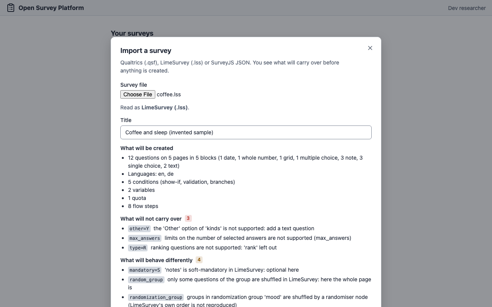{ loading=lazy width="1280" height="800" }

## Open science built in

**Preregister the exact instrument, and let anyone replay your data.**

- **Versioned publishing**: every response records the version and checksum of the survey
  it saw.
- A **preregistration bundle** per version, ready for OSF: the definition and its checksum,
  the codebook, randomisation and planned-exclusion notes and a readable summary, with an
  optional upload to an OSF project.
- A **reproducibility package** per version that replays any response with the exact
  engine that ran it.
- **AI drafting** through an MCP server: describe your study to an assistant and review
  its draft in the builder. It can draft, never publish.

[Read more: preregistration](preregistration.md) ·
[reproducibility package](publishing.md#the-reproducibility-package) ·
[AI drafting](ai-drafting.md)

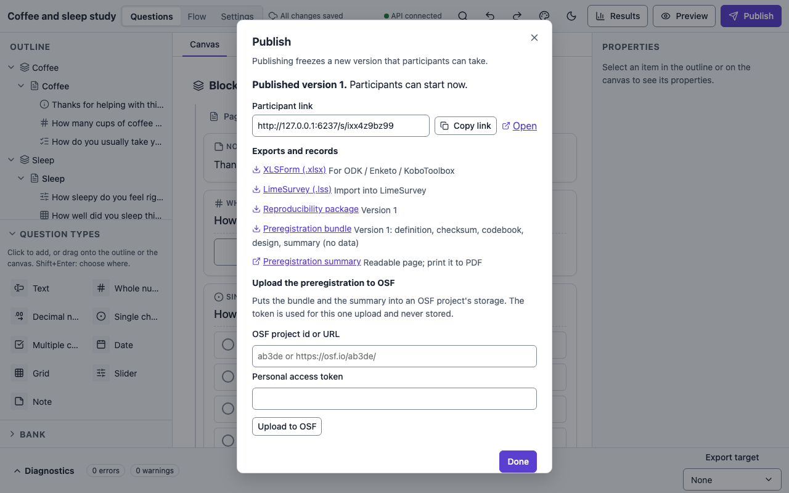{ loading=lazy width="1280" height="800" }

## Yours to run, open to everyone

**Self-hosted, MIT-licensed and built for accessibility.**

- **Self-hosting with your own sign-in**: the platform has no accounts or passwords. Your
  university system, a Django app or a single sign-on proxy signs researchers in and
  forwards signed identity headers.
- One **Docker image** with the API, the participant app and the builder files; Postgres or
  SQLite. The hosting guide includes a minimal Django example and Dokku notes.
- **Privacy**: answers encrypted at rest (AES-256-GCM), labs kept apart, retention periods
  enforced, no participant IP address stored or logged.
- **MIT licence**, with permissive dependencies only.
- **Accessibility**: axe checks run throughout the end-to-end tests, key screens are tested
  at 320 px wide, and the builder can be driven entirely from the keyboard.

[Read more: hosting](hosting.md) · [contributing](reference/contributing.md)

<figure markdown="span">
  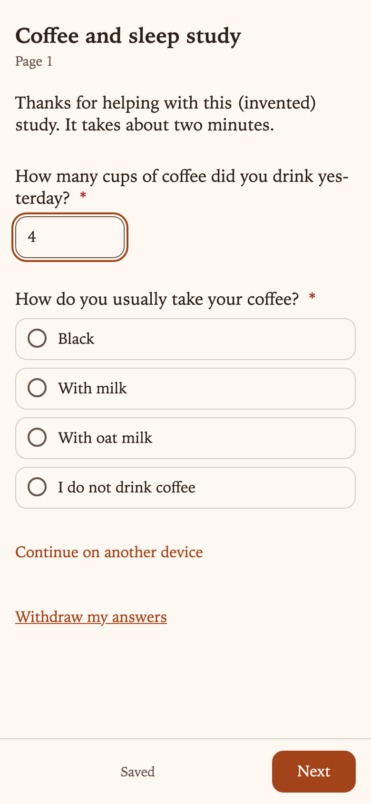{ loading=lazy width="300" height="649" }
  <figcaption>The participant app at phone size.</figcaption>
</figure>

## How it compares

A factual comparison with typical hosted (software-as-a-service) survey tools. Individual
products differ; check the ones you are considering.

| | Open Survey Platform | Typical hosted survey tools |
|---|---|---|
| Source code | Open source, MIT licence | Usually closed source |
| Where the data lives | Your own server and database | The vendor's servers |
| Self-hosting | Yes: one Docker image, behind your sign-in | Not usually offered |
| Cost | Free software; you pay for your own hosting | Subscription or per-response pricing, often with a limited free tier |
| Researcher accounts | Your institution's sign-in | Usually an account with the vendor |
| Reproducibility package (replay any response) | Every published version | Not usually offered |
| Preregistration export | OSF-ready bundle with checksum, codebook and design | Usually assembled by hand from exports |
| Randomisation record | Seeded; every order and assignment stored with the response | Varies; often only the condition |
| Missing answers in exports | Each one labelled: unanswered, irrelevant or not reached | Often blank cells or numeric codes |
| Survey export to other tools | XLSForm and LimeSurvey (Qualtrics and SurveyJS coming soon) | Usually the vendor's own format |
| Maturity and support | Early development; community support | Established products with support teams |

## See it in action

Three scripted demo videos show building a survey, publishing it and a participant
taking it on a laptop and then a phone. They are regenerated from the code with
`make demo-videos`; [Demo videos](demos.md) has their chapter lists and how to record
them.

[Get started](getting-started.md){ .md-button .md-button--primary }
[Read the guide](building-a-survey.md){ .md-button }
