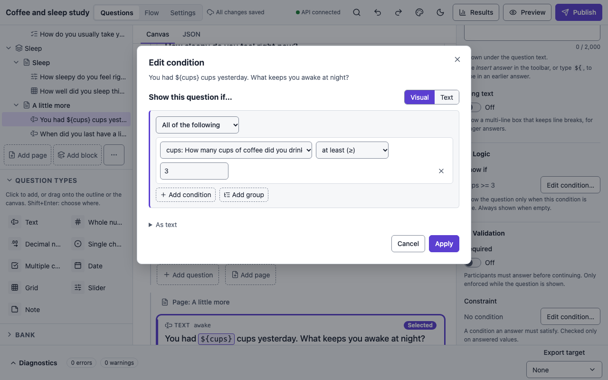
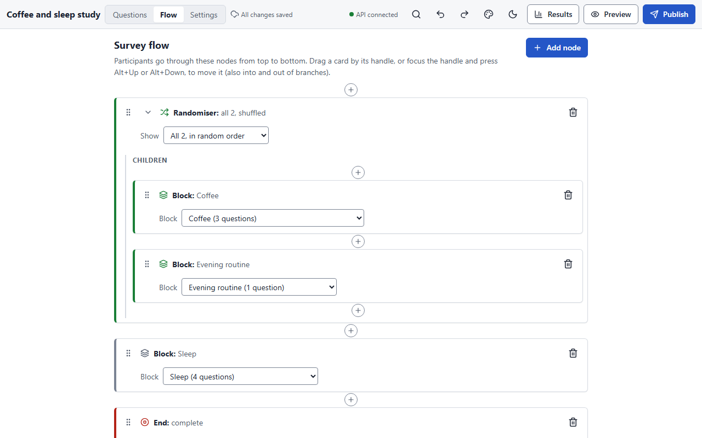

# Logic and flow

A survey's behaviour comes from three things: **display conditions** on questions and
pages, the **flow** (which blocks a participant sees, in what order), and **piping** (text
that repeats an earlier answer). This page describes each, and how missing answers behave.
The authoritative definition is
[`planning/semantics.md`](https://github.com/andytwoods/open-survey-platform/blob/main/planning/semantics.md);
the engine, the simulator and the exports are all tested against it.

## Display conditions (show if)

Every question and every page has an optional **Show if** condition. When it is false the
question (or the whole page) is skipped, and its answers are recorded as *irrelevant* rather
than blank (see [Missing answers](#missing-answers)).

In the builder, select a question and use **Show if → Edit condition…** in the properties
panel. The condition editor builds the expression from rows: a question, an operator and a
value, combined with *and* / *or*. The text view shows the same condition as an expression
you can edit directly.

<figure markdown="span">
  { loading=lazy }
  <figcaption>A follow-up question shown only when the earlier answer is at least 3.</figcaption>
</figure>

### The expression language

Expressions are small and pure: no randomness, time or network.

| Kind | Examples |
|---|---|
| References | `cups`, `nights_weeknights` (a question's id, or a grid row's `<grid id>_<row id>`) |
| Literals | `5`, `-3`, `2.50`, `"text"`, `true`, `false`, `null` |
| Comparison | `==`, `!=`, `<`, `<=`, `>`, `>=` |
| Arithmetic | `+`, `-`, `*`, `/` (division always gives a decimal) |
| Logic | `and`, `or`, `not` |
| Functions | `answered(q)`, `contains(q, "code")` (multiple choice only), `if(cond, a, b)` |

Some examples:

```text
cups >= 3
answered(taken) and taken == 4
contains(symptoms, "headache") or contains(symptoms, "nausea")
if(answered(age), age < 40, false)
```

Rules worth knowing:

- Conditions refer to a question's **id**, never its export name. Ids are stable; names can
  be renamed freely.
- A reference must point **earlier** in the flow. Items on the same page may refer to each
  other, but not in a loop. A page-level condition may refer only to earlier pages.
- Choice answers are compared by their **codes** (values), never by their labels. Codes
  compare as text, so `1` and `"1"` are the same code.
- Numbers are decimals, not binary floats; arithmetic keeps 28 significant digits.
- Type mismatches (comparing text with a number, `contains` on a single-choice question, a
  number used as a condition) are errors that block publishing.
- A grid's rows are separate variables: refer to `<grid id>_<row id>`. The grid id itself
  has no value.

### Missing answers in conditions

Logic is two-valued. Comparing anything with a missing answer gives **false**, including
`null == null`; arithmetic with a missing answer gives `null`, which counts as false in a
condition. The practical consequences:

- `not contains(c, "x")` is **true** for someone who never answered `c`. The builder warns
  when `not` wraps a question that may be unanswered and suggests
  `answered(c) and not contains(c, "x")`.
- `if(age < 40, "young", "old")` gives `"old"` when age is missing. Write
  `if(answered(age), …, null)` to keep it missing.
- A question that was skipped, hidden or not yet reached reads as `null`.

### Validation (constraints)

Besides *required*, an answerable question can carry a **constraint**: a condition on its
own value that must hold, with a message shown when it fails. Numeric questions also have
inclusive `min` and `max` bounds. Constraints are checked only on answered values, when the
participant moves to the next page. Input the app cannot read as the question's type
(`12a` for a whole number, an impossible date, a slider value between steps) blocks the page
even on an optional question, so a stored value is always one the participant gave.

## Flow

Pages live in **blocks**, and the **flow** is a tree of nodes that decides which blocks a
participant sees. Open it from the top bar (**Flow**) or the command palette.

<figure markdown="span">
  { loading=lazy }
  <figcaption>Two blocks inside a randomiser, so participants get them in random order.</figcaption>
</figure>

| Node | What it does |
|---|---|
| **Block** | Shows a block's pages in order. A block appears at most once in the flow, so each question is one column in the export. |
| **Branch** | An *if* condition with a *then* list and an *else* list of nodes. There is no "go to": the flow is a tree with no cycles, so every session ends. |
| **Randomiser** | Shows its children in a seeded random order. With **pick** set to N, each participant gets N of the children, drawn without replacement. |
| **Assign** | Draws a value for one or more *assigned* variables (conditions), uniformly at random per variable. The draw is recorded with the response and is available to conditions and piping once the node is reached. |
| **Quota check** | Asks the server whether a quota still has room. A place is held at the check, used up on completion, and released after 24 hours without activity. When the quota is full, an optional block is shown (a thank-you or screen-out message), then the session ends with the quota's outcome. |
| **End** | Ends the session with an **outcome** (default `complete`) and an optional message. Reaching the end of the flow without an End node counts as `complete`. |

Outcomes are plain identifiers such as `complete`, `declined` (the consent page's default)
or `quota_full`. The export records each response's outcome in the `_end` column, so a
"screened out" outcome is simply an End node with that name.

### Endings

What participants see when the session ends is set **per outcome**, in
[Survey settings → Endings](settings.md#endings): a title and a text, so a screened-out or
quota-full participant can get a different screen (and a different tone) from a completer.
Every End node with the same outcome shares that ending; an End node's own **message** is
shown above it. The End card says which ending its outcome uses and has **Edit ending…** to
open it. An outcome without an ending shows the default screen: *Thank you* and the status
line.

The text can pipe answers and variables with `${id}`, as labels do: a piped value is
filled in for this participant and an unanswered question pipes nothing. Piped values are
always shown as text, never as HTML.

An ending can also send participants on afterwards, for example back to Prolific with a
completion code, automatically after a countdown or by a button; see
[Redirects](settings.md#redirects). Because the ending is keyed by outcome, a screened-out
participant can get a different code (or no redirect) from a completer.

### Randomisation is reproducible

Every session has a seed. Each random decision (a randomiser, a page's item order, a
question's choice order, each assigned variable) uses its own stream derived from the seed,
the node id and the published version, so changing one randomiser never changes the others.
The realised order is fixed when first reached and never re-rolled on back, refresh or
resume, and every response records the orders and assignments it saw. The reproducibility
package ([Publishing and exports](publishing.md#the-reproducibility-package)) recomputes them.

Shuffling is also available within a page (**item order**) and within a question's choices
(**choice order**). Grid rows and columns are never shuffled.

### Pages that are skipped

A page with nothing relevant on it is skipped silently and its questions become
*irrelevant*. A note counts as content, so a page holding only a note (a stimulus, a
screen-out message) is still shown. If going back and changing an answer takes a block off
the path, that block's answers are cleared and marked irrelevant; if the path later returns
to it, its questions are unanswered again.

## Piping

Write `${id}` in any label, help text or note to insert an earlier answer:

```text
You had ${cups} cups yesterday. What keeps you awake at night?
```

- A choice answer inserts its **label**; a multiple-choice answer inserts its labels in the
  order they were displayed, joined with ", ".
- A number inserts its canonical form (`2.5`, never `2.50`).
- A missing answer inserts nothing.
- Piped text is HTML-escaped, so it can never inject markup.

Built-in values live in the reserved `$` namespace:

| Built-in | Value |
|---|---|
| `${$trial}` | The number of the current page on the participant's path, starting at 1. Skipped pages do not count. |
| `${$position.index}`, `${$position.of}` | Position within the innermost randomiser and its size (its *pick*, or its number of children). Empty outside a randomiser. |
| `${$pagesDone}`, `${$language}`, `${$device}` | Pages completed so far, the participant's language, and the device class. |

Nothing can be piped into the consent page's text.

## Variables

Besides questions, a survey can declare variables in three kinds:

| Kind | Where its value comes from |
|---|---|
| **Embedded** | A URL parameter on the participant link, captured once at session start, with an optional default. A missing or malformed value is recorded as unanswered with a diagnostic; the participant is never blocked. |
| **Assigned** | An Assign node in the flow draws one of its levels. |
| **Computed** | An expression over earlier answers, evaluated by the engine. |

All three are exported as columns with their own state, like questions.

## Missing answers

Every question in a session is in exactly one state, and exports always say which:

| State | Meaning |
|---|---|
| `answered` | Shown and answered |
| `unanswered` | Shown and left empty (only possible when not required) |
| `irrelevant` | Its page was reached, but display logic hid it, or its block later dropped off the path |
| `not-reached` | The flow never got to its page |

CSV exports carry the state in a companion `<name>__state` column, and JSON in a `state`
field; the cell itself is empty. Codes such as `-99` are never written where they could be
averaged by mistake. See [Publishing and exports](publishing.md#response-exports).
