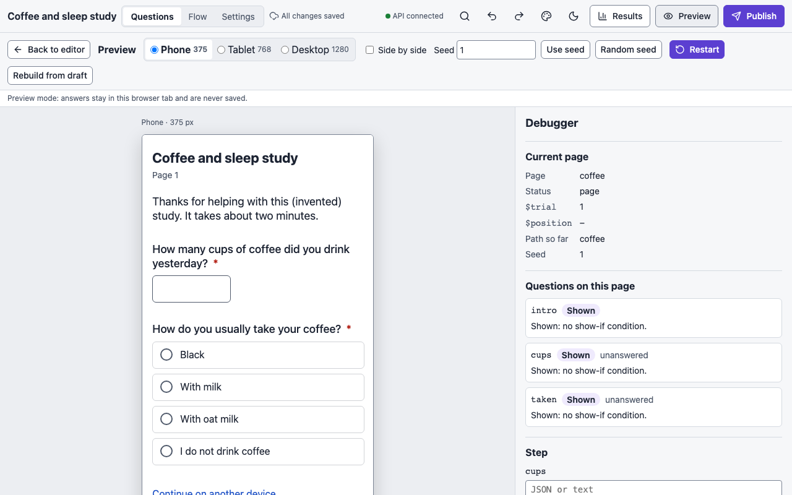
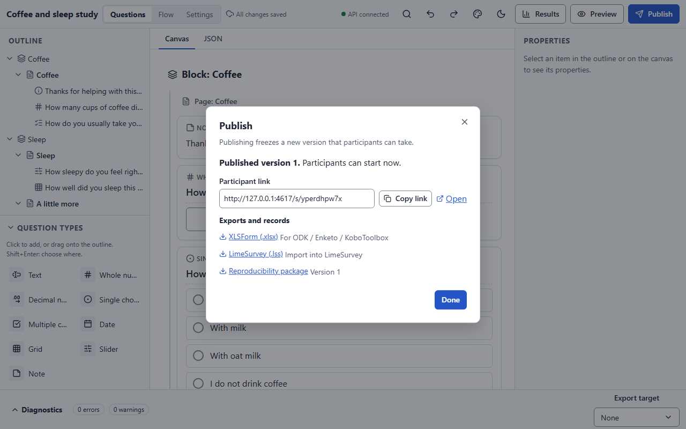
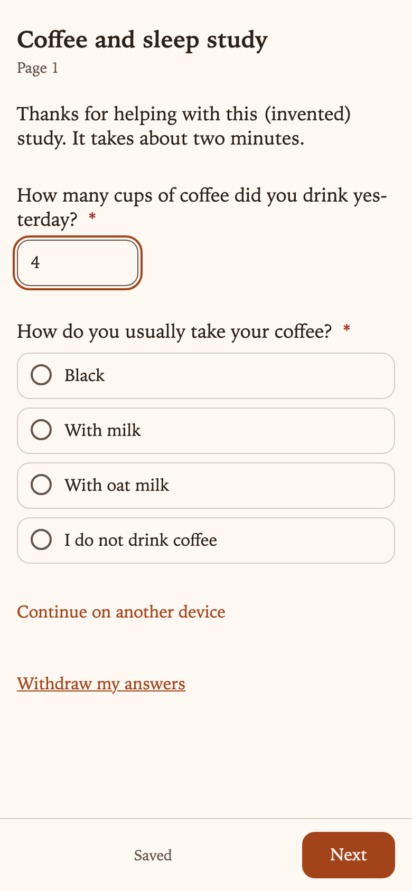

# Publishing and exports

Participants never see a draft. **Publishing** freezes the draft as a numbered version,
compiles it into the plan the participant app runs, and gives you the participant link.
Everything you collect is tied to the version that collected it.

## Before you publish: preview

**Preview** in the top bar opens the draft as participants will see it, in a **Phone**,
**Tablet** or **Desktop** frame or all three **Side by side**, without saving anything to
the server. The preview runs the same engine and the same sandbox as the participant app, so
conditions, randomisation and researcher hooks behave exactly as they will live. Pick a
**Seed** to reproduce one particular random order, **Restart** to start again, or
**Rebuild from draft** after editing.

<figure markdown="span">
  { loading=lazy }
</figure>

The **debugger** alongside shows the current page, status and path so far, which questions
on the page are shown or hidden and why, the realised randomisation and conditions, any
researcher hooks that ran, and the event log. It can step with **Next page** and **Back**,
load a script of answers and play it, and **Export run as script**. **Simulation** plays a
number of random participants through the survey and reports unreachable nodes, balance
checks, outcomes and warnings.

## Publish

Press **Publish** in the top bar. Publishing freezes a new version that participants can
take, so the platform first checks the survey and lists anything that stops it, each with a
link to where it is fixed:

- **Validation errors** such as a condition that refers to a later question, a type
  mismatch, two export names that differ only by case, or a duplicate id.
- **Data retention must be chosen** before the first publish (**Choose data retention**).
  Choose it under [Settings](settings.md#data-retention); there is no silent default.
- **The theme must pass the contrast check** (**Fix in Appearance**).

A survey without a consent page publishes with a warning (**Edit consent**), not an error.

When the checks pass, the dialog shows **Published version N. Participants can start now.**
with:

- the **Participant link**, with **Copy link** and **Open**;
- any remaining warnings;
- **Exports and records**: **XLSForm (.xlsx)**, **LimeSurvey (.lss)**, the
  **Reproducibility package** for this version (all below) and the
  **Preregistration bundle** and summary ([Preregistration](preregistration.md)), with
  an optional upload to an OSF project.

<figure markdown="span">
  { loading=lazy }
</figure>

### Versions

- Every publish creates the next version number. Changing a published survey and
  publishing again is always a new version; the participant link stays the same, new
  sessions start on the newest version, and sessions already in progress finish on the
  version they started.
- Each response records the version and checksum it saw, so exports can tell them apart. A
  combined export of several versions splits a question whose type or choices changed into
  `<name>_v<N>` columns, and the codebook notes the change.
- Published surveys cannot be deleted.

### The participant link

The link is the public URL template (set by your host as `OSP_PARTICIPANT_URL_TEMPLATE`)
with the survey's slug filled in; in `make dev` it points at the local participant app.
Participants need no account. Add URL parameters to feed **embedded variables**
([Logic and flow](logic.md#variables)).

What a participant gets:

- One page at a time, with **Back** unless the survey turns it off, and progress saved as
  they go (or only at the end, in *end-only* mode).
- A refresh returns to the same page with the same answers and the same random order.
- A private **resume link** to continue on another device. It expires after 30 days
  without activity by default.
- The consent page first, if the survey has one; nothing is stored before agreement, and
  withdrawal is available from the end screen or the resume link.
- Participants are never asked to sign in, and no IP address is stored or logged.

<figure markdown="span">
  { loading=lazy }
  <figcaption>The participant app at phone size.</figcaption>
</figure>

## Response exports

The responses of one version, or of all versions combined, are available as **CSV** or
**JSON**, with a companion **codebook** (Markdown or JSON) that documents every column,
every code and every label, in every language, plus the consent texts if there were any.
Today the builder has no download button for them: fetch them from the API
([exportResponses](reference/api.md#exportResponses) and
[exportCodebook](reference/api.md#exportCodebook), with the export role), or download the
[reproducibility package](#the-reproducibility-package) with its data. In `make dev` the
links are `http://localhost:8000/api/surveys/<id>/export/responses?format=csv` and
`…/export/codebook?format=md`.

| Option | Meaning |
|---|---|
| `format` | `csv` or `json` |
| `version` | One published version; omitted, all versions combined (adds a `_version` column) |
| `stateColumns` | Add a `<name>__state` column per variable (default on) |
| `multi` | Multiple-choice answers as one 0/1 column per choice (`columns`, the default) or as codes in one cell |
| `excel` | CSV with a UTF-8 byte order mark so Excel reads it correctly |
| `events` | JSON only: include each response's event log |

What the columns are:

- **Metadata** such as `_response_id`, `_session_id`, `_version`, `_plan_checksum`,
  `_seed`, `_started_at`, `_submitted_at`, `_end` (the outcome), `_language`, `_late`
  (arrived after the session's holds had expired), `_after_close`, and
  `_consent_version` / `_consented_at` for versions with a consent page.
- One column per **assigned condition**.
- **Questions** in flow order, named by their export name. A grid gives one column per row
  (`<grid name>_<row id>`); a multiple-choice question one 0/1 column per choice.
- **Embedded and computed variables.**
- The **realised orders** (`_order.blocks`, `_order.items.<page>`, `_order.choices.<q>`).

Missing answers are always labelled: the cell is empty and the `__state` column says
`answered`, `unanswered`, `irrelevant` or `not-reached`
([Logic and flow](logic.md#missing-answers)). Numeric missing codes are never written into
CSV. Cells that start with `=`, `+`, `-` or `@` are escaped, so a spreadsheet never runs
them as formulas.

## Exporting the survey itself

The platform can write the survey for other tools. Both exports take the **draft**, and
each has a **capability table** that says, feature by feature, whether the target represents
it natively, lowers it, approximates it or cannot carry it. Choose an **Export target** in
the editor's diagnostics strip to see them before exporting: as a list, and as badges on
the questions concerned.

| Target | File | What does not carry over |
|---|---|---|
| **XLSForm** (ODK, Enketo, KoboToolbox) | `.xlsx` | Quotas, turning Back off, page and block order shuffles, consent, settings and theme, licence and DDI metadata; per-run language spans in formatted text |
| **LimeSurvey** | `.lss` | Consent, save mode, retention and theme; a slider becomes a number box without its end labels; shuffles use LimeSurvey's own unseeded randomiser; assignment, computed values and quota behaviour are approximated |

[Formatted text](building-a-survey.md#formatting-text) is written in each target's own
markup. XLSForm labels, hints and constraint messages get the Markdown subset Enketo and
ODK Collect render: `**bold**`, `*italic*`, `[text](https://…)`, `#` headings (absolute
sizes, so they are reported as lowered), `- ` and `1. ` lists (Enketo shows a list, Collect
shows the markers, so lists are reported as approximated) and line breaks; a language span
is lost. Because those characters are markup there, a literal `*`, `_`, `#` or `\` in any
text, plain strings included, is written with a backslash in front so it shows as written.
Only `<`, `>` and the `[text](url)` pattern have no escape and are still reported as
`$text.markup`. LimeSurvey texts are HTML, so formatting becomes `<strong>`, `<em>`, `<a
target="_blank" rel="noopener noreferrer">`, `<span lang>`, `<p>`, `<h3>`–`<h5>`, `<ul>` /
`<ol>` and `<br />`, with the text itself escaped; a formatted page title is HTML in the
group description and plain text in the group name.

## The reproducibility package

Every published version has a **reproducibility package**: a deterministic ZIP that lets
anyone replay a response with the exact engine that ran it.

```text
README.md  LICENSE.md  manifest.json  checksums.sha256
survey/   survey.json  plan.json  runtime-config.json
exports/  survey.xlsx  survey.lss  (+ their diagnostics)
replay/   replay.py  replay.mjs  engine.js
data/     codebook.md  codebook.json  responses.csv  responses.json   (with data only)
```

`replay.py` recomputes every random order and assignment from a seed; `replay.mjs` plays a
response's event log through the bundled `engine.js`. The link in the publish dialog gives
the package without data, which needs only read access, so a viewer can download it; add
`?data=true` to the same URL ([reproPackage](reference/api.md#reproPackage)) for the
responses and codebook, which needs export rights. A deployment should build the engine
bundle (`make engine-bundle`) so the package can include `replay.mjs`; if the bundle is
missing, the package says so.
