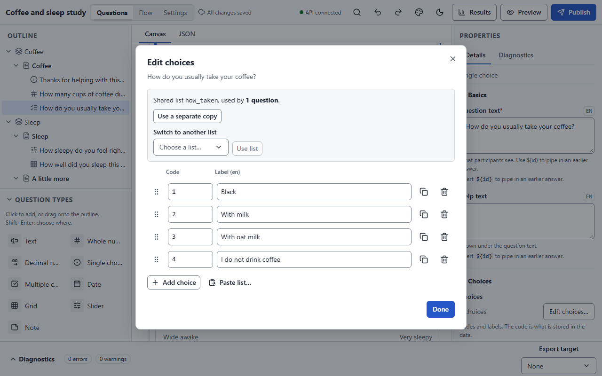

# Question types

Nine types cover most research surveys. A question's type can be
[changed later](building-a-survey.md#changing-a-questions-type) without losing its text or
logic. Every answerable type has the same core fields in the properties panel:

| Group | Field | Meaning |
|---|---|---|
| Basics | **Question text**, **Help text** | What participants read. Both can be translated and can pipe in earlier answers with `${id}`. |
| Logic | **Show if** | A [display condition](logic.md#display-conditions-show-if). |
| Validation | **Required** | The page cannot advance until the question is answered, while it is shown. |
| Validation | **Constraint**, **Constraint message** | A condition the answer must satisfy, and what to say when it does not. |
| Advanced | **Variable name** | The column name in exports (defaults to the id). |

## Text

> A typed answer: a word, a sentence or a paragraph.

**Long text** turns the single-line box into a multi-line one. Leading and trailing
whitespace is trimmed, and a whitespace-only answer counts as unanswered. Text is never
altered otherwise: accents, line breaks and emoji are kept exactly. There is no length
limit; use a constraint if you need one.

## Whole number

> A number without decimals, such as an age or a count.

**Minimum** and **Maximum** (Validation) are inclusive bounds. Input that is not a whole
number (`12a`, `3.5`) blocks the page even if the question is optional.

## Decimal number

> A number that may have decimals, such as a weight.

As for whole numbers. Decimals are exact (not binary floats), kept to 28 significant
digits, and stored in canonical form: `2.50` becomes `2.5`, `.5` becomes `0.5`.

## Single choice

> Pick one option from a list.

**Choices** opens the [choices editor](#the-choices-editor). **Choice order** is *As
listed* or *Shuffle per participant*; a shuffle is seeded, so a participant sees the same
order on every visit and the order is recorded with the response. The stored value is the
choice's **code**, never its label.

## Multiple choice

> Tick all the options that apply.

As single choice, but the answer is a set of codes. In conditions use
`contains(q, "code")`. Exports give one 0/1 column per choice by default.

## Date

> A calendar date.

A date picker. Impossible dates are refused as unreadable input. There is no built-in
range; a constraint can compare the date with another date question.

## Grid

> Rows of statements, each rated on the same columns.

A grid (matrix) has **Rows** (the statements) and **Columns** (one shared choice list).
Each row is its own variable in the data, named `<grid name>_<row id>`, with its own
state. **Every row required** sets the default; the rows editor can switch it per row.
Rows and columns are never shuffled, and rows have no display condition of their own; use
separate questions if you need that.

In conditions, refer to a row as `<grid id>_<row id>`, for example `nights_weeknights`.

## Slider

> Pick a number by dragging along a track.

**Left end**, **Right end** and **Step** define the grid of allowed values (default 0 to
100 in steps of 1); **Left label** and **Right label** are the words at each end. **Values**
(Advanced) chooses whole numbers or decimals. A slider starts *unanswered*: there is no
value until the participant moves it, so a required slider blocks the page until it is
touched, and an untouched optional slider is recorded as unanswered rather than its
midpoint. A typed value between steps is refused rather than rounded.

## Note

> Display text for participants; nothing to answer.

A note has **Text**, **Help text** and **Show if** only. It stores nothing and has no
column in the data. A page that holds only a note is still shown (a stimulus or a screen-out
message), whereas a page with no relevant items at all is skipped.

## The choices editor

<figure markdown="span">
  { loading=lazy }
</figure>

**Edit choices…** opens the editor for a single or multiple choice question, or a grid's
columns. Edits save as you go; **Done** closes it.

- Each row has a **Code** and a **Label**. Codes are what the data holds and what conditions
  compare; labels are what participants see and can be translated. Codes contain no
  whitespace, and a list that mixes number and text codes gets a warning.
- **Add choice** adds a row; drag the handle, or press ++alt+up++ / ++alt+down++, to
  reorder; **Duplicate** and **Delete** act on one row (the last choice cannot be deleted).
- **Paste list…** takes one choice per line and either replaces the list or adds to its
  end, with a preview of the codes it will assign.
- **Make shared…** turns the list into a shared choice list with its own id, so several
  questions (a Likert scale, say) use one list; **Use a shared list** picks an existing one
  and **Use a separate copy** detaches again. Editing a shared list changes every question
  that uses it.
- Changing a code after the survey has been published asks for confirmation, because data
  already collected uses the old code.

The **Edit rows…** editor for a grid works the same way: label, order, delete, and a
per-row **Required** switch, with each row's data variable shown.
