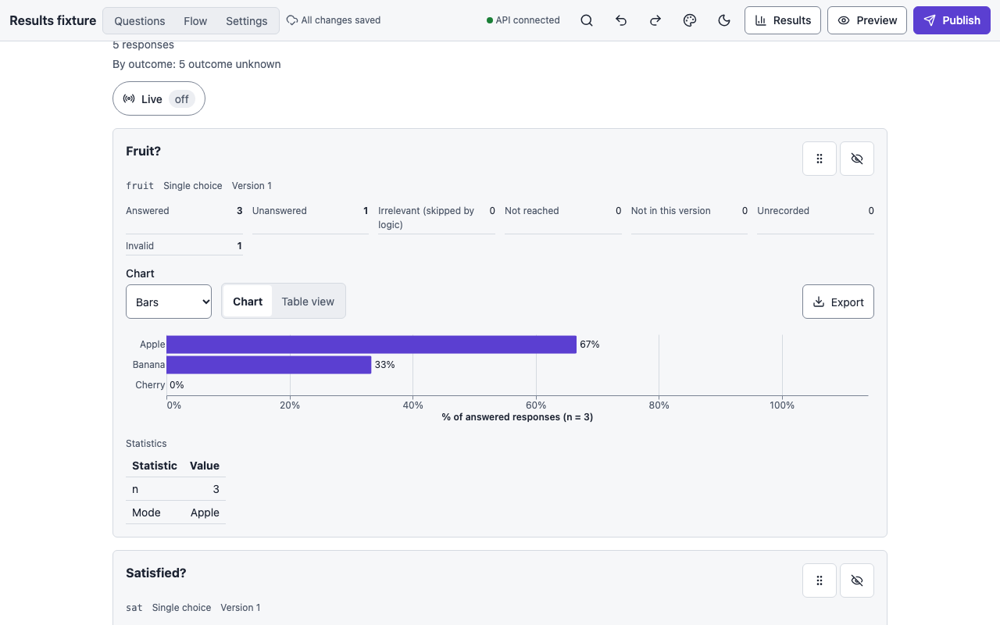
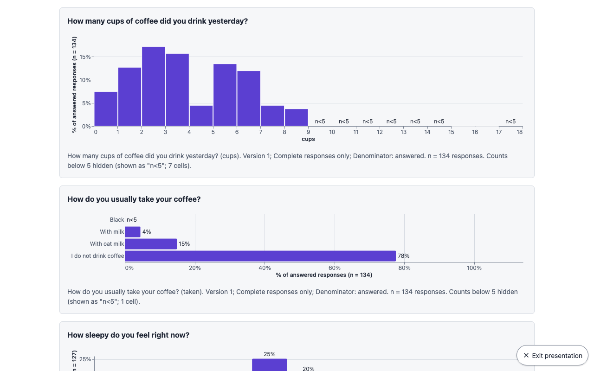

# Results

**Results** in the top bar (or **Open results** in the palette) shows the responses to a
published survey: one card per question, each with counts, statistics, a chart and a table.
It needs the export role (owner or editor); a viewer sees a "no access" message. Counts are
of responses, not participants.

<figure markdown="span">
  { loading=lazy }
</figure>

## Filters

**Show filters** opens the filter bar. Press **Show results** to apply; **Reset filters**
clears it.

| Filter | What it does |
|---|---|
| **Survey version** | Tick the versions to include. None ticked means the latest version. Versions are combined only when a question's type and codes match; otherwise its card shows one facet per version, with a warning. |
| **Responses** | *Complete only* (the outcome was `complete`) or *All submitted*. |
| **Submitted from**, **Submitted to (inclusive)** | A date range. |
| **Condition** | Keep responses assigned to given levels of a condition. |
| **Answer filters** | Keep responses that gave given answers to a single choice, multiple choice or grid row question (up to 20). |
| **Split by** | Compare groups: by a question (single choice, grid row) or by a condition. Each group gets its own *n*, and numeric cards share bin edges across groups. |
| **Denominator** | *Answered* (default) or *Shown (answered + unanswered)*: what percentages are out of. |
| **Show 95 % intervals** | Wilson intervals for proportions, *t* intervals for means. |
| **Labels in** | Which language's labels to show. |

The active filters are shown in words above the cards, with the number of responses. A
second line, **By outcome**, counts every submitted response of the versions shown by how
the session ended ("12 complete · 3 screened out · 1 quota full"), before any filter. The
outcomes are the survey's own End node names (see [Logic](logic.md#flow)); "outcome
unknown" counts responses stored without one, which the *Complete only* filter keeps.
These counts are read from a plain column, never from the encrypted answers.

## Cards

Each card shows the question's **response states** (answered, unanswered, irrelevant, not
reached, not in version, unrecorded, invalid), the **statistics** that make sense for its
type (n, mode, median, mean, standard deviation, quartiles, min and max for numbers;
earliest and latest for dates; mean number of options for multiple choice; mean length for
text), and "not available" where a statistic is undefined, such as a standard deviation
with fewer than two answers.

**Show as** switches between the **Chart** and the accessible **Table view**. The **Chart**
menu offers, by type:

| Type | Charts |
|---|---|
| Single choice | Bars, Sorted bars, Donut |
| Multiple choice | % of respondents, Counts, Dot plot. Percentages are of answering respondents, so they can sum to more than 100. |
| Numbers and sliders | Histogram (or Frequency bars for few distinct values), Box plot, Cumulative distribution |
| Date | Counts per period, with **Per** Day, Week, Month or Year |
| Grid | Diverging stacked bars (neutral centred), 100 % stacked bars, Heatmap; or Grouped bars and Heatmap for unordered columns |
| Text | Response states, and **Show answers** for the verbatim answers in pages (reading them is audited) |

With a split, **Groups** chooses *Grouped bars*, *100 % stacked bars* or *Small
multiples*. Charts are drawn with Vega-Lite as SVG, follow the page's theme (below), and
carry titles and descriptions for screen readers.

## Theme

**Theme**, above the cards, chooses the colours the cards and every export are drawn in,
independently of the survey:

- **App colours (default)**: the builder's own light or dark colours on screen; exported
  figures use the print theme (white background, the Okabe-Ito colour-blind-safe palette).
- **This survey's theme**: what participants see: the survey's own theme from the
  Appearance view, else the lab's default theme, else the Clean preset.
- A built-in **preset** (Clean, Warm, High contrast, Dark, Compact) or a theme from the
  **lab theme library**.

The note under the picker says what is showing. A theme is checked for what charts draw:
text on the background needs 4.5:1 contrast, bars and axis lines 3:1; a theme that fails
is still shown, with a warning. Themes that follow the device show in the builder's light or
dark mode and export in their light colours; a dark-only theme exports dark. The choice is
kept in a saved layout as a reference; if the lab theme is later deleted, the layout falls
back to the app colours and says so.

## Live

**Live**, next to the response count, keeps the page up to date as responses arrive. It is
off by default. With it on, the page asks the server every few seconds whether anything
changed (a cheap check that reads no answers and is not audited) and re-queries only when
something did:

- **Hands off, it refreshes by itself.** Cards whose numbers changed get a short outline
  pulse (none with reduced motion), each card keeps its height while its chart is redrawn,
  and a screen reader hears one line per refresh: "Results updated: 142 responses".
- **While you are working** (you touched the page in the last few seconds, a menu or dialog
  is open, or the filters have changes you have not applied yet), nothing moves: a badge
  says **3 new responses · Refresh**, and Refresh applies them when you are ready.
- **Text answers never refresh by themselves.** An open answers page keeps what it shows
  and offers **Reload answers** when new ones have arrived.
- A hidden tab stops checking and checks again the moment you come back. If the server
  cannot be reached, the page keeps the last results and tries again, waiting longer each
  time. Losing access to the survey turns Live off and says so.
- In presentation mode, Live refreshes in batches and hides small counts (below).

The status line says what Live is doing: "Checking every 10 s · updated 14:32". The
interval is the server's (`OSP_LIVE_POLL_MS`, 10 s by default). The choice is kept in the
URL (`?live=1`) and, as a setting, in a saved layout, so a layout for a lab screen opens
live; layouts saved before this open with Live off. Automatic refreshes are recorded in the
audit log as `results.live`, one row per person and query per quarter hour; pressing
Refresh or Show results is an ordinary `results.read`.

## Presentation mode

<figure markdown="span">
  { loading=lazy }
</figure>

**Present** opens a small dialog, then hides everything but the cards: no top bar, filters,
layout bar or per-card controls, just each question's title, its chart (or table) and its
caption, on the theme's background, with a footer such as "142 responses · updated 14:32 ·
live · counts below 5 hidden". Press **Escape** or the floating **Exit presentation** button
to come back. The URL gains `?present=1`, so the view can be shared with a colleague who has
access or printed from the browser; `?layout=<id>` in the same URL opens a saved layout.
**Present results** in the palette enters with the defaults below.

The dialog's choices, for a screen in a room:

- **Live: Refresh as responses arrive**, on if Live is on. **In batches** (the default) the
  screen redraws only when five new responses have arrived, or ten minutes have passed since
  it last redrew, whichever comes first, so the audience never sees one person's answers
  land. **On every change** redraws at once. The cadence travels in the URL (`?live=1` for
  batches, `?live=every`), so a link opened on the lab screen keeps it.
- **Small counts: Hide counts below 5 on screen**, on by default. Hidden cells read "n<5" in
  charts and tables and the caption says how many are hidden, as in a suppressed export.
  Switching it off shows exact counts and a warning: in a room, the person who just pressed
  Submit can be told from the card that moved. The switch is made afresh each time and is
  never read from the URL: a shared link always opens suppressed.
- **Fullscreen** asks the browser for fullscreen; the first Escape then leaves fullscreen,
  the second leaves presentation. While live, the screen is kept awake where the browser
  allows it.

The footer shows the response count and the time of the last redraw, never how many
responses arrived since. Text answers are never shown in presentation mode. When the host
session expires, the sign-in banner appears and Live stops.

## Exporting figures

Every card has an **Export** menu: **PNG image…**, **SVG image…**, **CSV of the numbers…**
or **Vega-Lite spec and manifest…**. The export dialog offers:

- **Final width**: *Single column, 85 mm*, *Double column, 180 mm*, or custom, with the
  real pixel size shown; **PNG resolution** 150, 300 or 600 DPI. SVGs are sized in
  millimetres and PNGs carry their DPI, so a figure drops into a manuscript at the right
  size.
- **Small counts: Hide counts below k**, off by default, for publication where small cells
  could identify someone. Hidden cells show "n<5" and no count or share anywhere in the
  figure, the CSV or the spec. Cumulative and box plots are drawn from every answer, so
  suppression cannot hide small cells in them; the dialog says so.
- A **Caption**, with **Use the automatic caption** as a start, drawn under the figure.

Figures use the page's theme (above): by default the print theme, white background with the
Okabe-Ito colour-blind-safe palette and ordered palettes for scales; with a theme chosen, its
colours at the same text sizes. The manifest records which.

**Export all** downloads one ZIP with a file set per shown card, in the page's order, plus
one manifest. **Contents** chooses *SVG only*, *PNG only* (at the width and resolution
chosen) or *Everything* (SVG, PNG, CSV and spec). Width, resolution, "Hide counts below k"
and the contents choice are kept in a saved layout.

Every query and every figure export is recorded in the audit log with the filters used and
the versions, never with answer values.

## Data exports

The results page aggregates; it never shows raw rows except the audited text pages. The raw
data, with a codebook, comes from the response export
([Publishing and exports](publishing.md#response-exports)).
