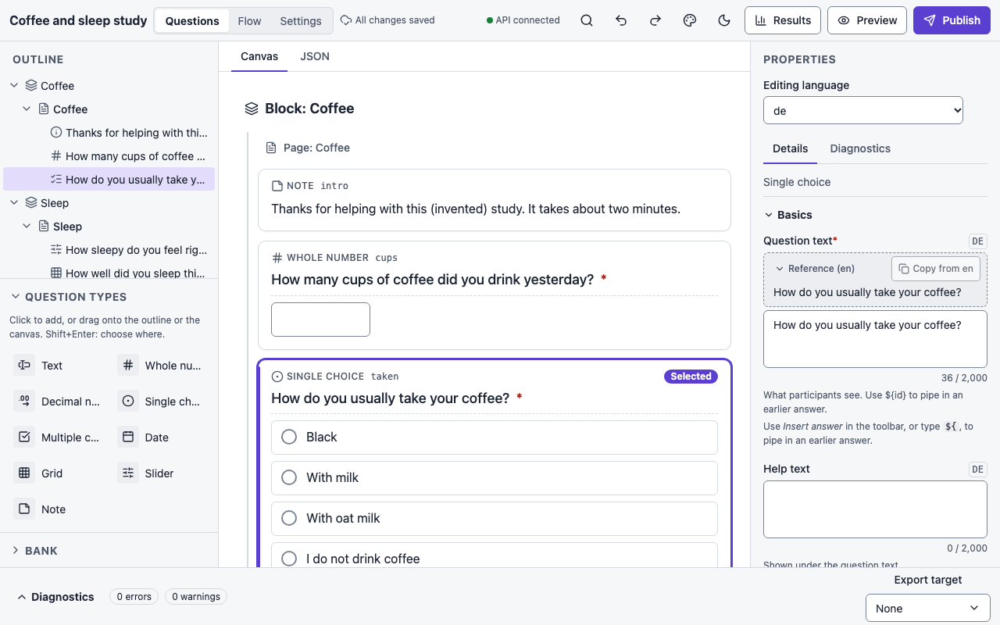
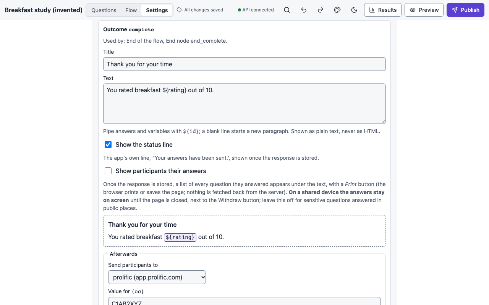

# Settings, consent and languages

**Settings** in the top bar (or **Open survey settings** in the palette) covers how the
survey saves, what participants can do, how long data is kept, consent and endings.

<figure markdown="span">
  { loading=lazy }
</figure>

## Saving responses

| Setting | Options | Notes |
|---|---|---|
| **Saving** | *Save to the server on every page* (default) or *Send nothing until the end* | With every-page saving, drop-outs are visible as partial sessions and a participant can resume on another device. With end-only saving nothing leaves the device before the final submit, so drop-outs are invisible. |
| **Copy kept on the device (end-only)** | *Browser storage* (default) or *Memory only* | Where the end-only copy lives. A memory-only copy is lost on refresh: the session restarts from the first page with the same seed and conditions, and the participant is told. If browser storage is blocked, the app falls back to memory, never to the server. |

Saving never loses an answer that reached the page: a refresh or a closed tab straight after
typing keeps the last answer, even with browser storage blocked.

## Moving through the survey

- **Allow going back** (default on). Going back re-evaluates later pages; an answer that is
  no longer relevant is cleared when the page is submitted.
- **Resume link expires after (days)**, default 30. The private resume link stops working
  after that many days without activity.

## Data retention

A retention policy is **required before you can publish**; there is no default.

| Option | Meaning |
|---|---|
| **Delete a set number of days after the survey closes** | Enter **Days after the survey closes**. |
| **Delete after a date** | Enter **Delete after this date**. |
| **Keep until I delete it** | An explicit "indefinite". |

Press **Save retention**; the status reads *Retention is set.* or *Not set yet: publishing
is blocked until you choose.* The chosen policy goes into the codebook with the data.

## Languages

<figure markdown="span">
  { loading=lazy }
</figure>

A survey can carry its text in several languages. Under **Languages**, add a language by its
tag (`de`, `pt-BR`), remove one (the builder asks before deleting its translations), and
choose the **Default language**.

With more than one language, an **Editing language** select appears at the top of the
properties panel (and on the flow page, and beside the consent and endings editors): every
text field then edits that language, shows its tag and flags a **Missing translation**; the
diagnostics list them as warnings. While you edit a language other than the default, each
field shows the default-language text above it as a read-only **Reference** (formatting and
piped answers included; collapse it once and every field's reference stays collapsed) with
**Copy from &lt;default&gt;** to start the translation from it. Formatting may differ per
language. The choice is kept in the page's address (`?lang=de`, so a link opens the same
language) and remembered for the survey. Participants get the language their browser
prefers: an exact match, then the same primary language, then the default.
Exports store choice codes, not labels, so the data is the same whatever language a
participant saw; the `_language` column records it, and the codebook has the labels in
every language.

## Consent

Tick **Show a consent page before the first question** to add a consent page. It is
survey-level (shown first, at most once, never inside the flow), with **Consent text**, the
**Agree button** label (default *I agree*) and the **Decline button** label (default *I do
not agree*), each translatable with the **Editing language** selector. A **Preview** shows
what participants will see. Nothing can be piped into consent text.

What the platform guarantees:

- **Before agreement nothing about the participant is saved**, in either save mode: the
  server creates a session with only its seed and assignment, stores no URL parameters, and
  refuses saves and submits until the participant has agreed to exactly this version of the
  text.
- The consent **version** is a hash of the text in every language, so any wording change is
  a new consent version. The response records which version was agreed and when, exported
  as `_consent_version` and `_consented_at`, and the codebook includes the texts.
- **Decline** ends the session with the outcome `declined`: no response and no audit entry
  are recorded, and the session is deleted. Tick **Count declines** to keep an anonymous
  per-publication count.
- **Withdrawal** is available after agreeing, from the end screen or the resume link. It
  deletes the response and the session, and the resume link stops working. The audit entry
  records the reason and how many responses were deleted, never any answer.

A survey without a consent page publishes with a warning, not an error, since consent may
be taken elsewhere.

## Endings

<figure markdown="span">
  { loading=lazy }
</figure>

One card per **outcome** the survey can end with: `complete` (the end of the flow, and any
End node left at the default), each End node's outcome, each checked quota's outcome when
full, and the consent decline. **Used by** lists where each comes from. Click **Customise
ending for …** to give an outcome its own screen:

- **Title**: the heading. Empty: *Thank you* in the participant's language.
- **Text**: shown under the heading (after the End node's own message, if it has one).
  Pipe answers and variables with `${id}`; a blank line starts a new paragraph. It is shown
  as plain text, never as HTML. The **Preview** shows pipes as tokens.
- **Show the status line**: the app's own line under the text, *Your answers have been
  sent.*, shown once the response is stored. You can hide it, but you cannot replace it with
  your own wording, so participants are never told something about their data that is not
  true. After a consent decline the line is always *Nothing about you has been recorded*.

- **Show participants their answers**: once the response is stored, a list of every
  question they answered, in the order they saw them, with the labels and the answers as
  shown on screen (a choice's label, a matrix row by row), and a **Print** button. The
  browser prints or saves the page; the print layout keeps only the ending and the list.
  The list is built in the participant's browser from the answers just sent, never fetched
  back from the server, and it is shown only on the page that sent them: a reload, a resume
  link or a withdrawal shows the ending without it. It is never available for the consent
  decline, which records nothing. **Privacy on a shared device:** the answers stay on
  screen until the page is closed, next to the Withdraw button, so leave this off for
  sensitive questions answered in public places.

- **Afterwards**: where to send participants once the response is stored (see
  [Redirects](#redirects) below). *Nowhere* keeps them on this screen.

**Use the default screen** removes the ending. An ending for an outcome nothing in the
survey reaches is kept, with a warning. Every outcome's screen can be tried in the
**Preview**. In exports, the `complete` ending becomes the XLSForm's final note group and
LimeSurvey's end text, and a quota's ending becomes its LimeSurvey quota message (see the
capability report for the details).

### Redirects

An ending can send participants on to another site after the survey, typically back to a
panel such as Prolific with a completion code. Nothing is sent before the server has
acknowledged the submit (or the decline), and a redirect fires at most once: a resumed or
reloaded page that finds the response already stored shows the ending without it.

**Redirect templates** (at the bottom of the Endings card) declare the destinations once:
a short name and an `https://` address with `{name}` placeholders after the site, such as
`https://app.prolific.com/submissions/complete?cc={cc}`. Each placeholder has a pattern its
value must match in full (default `[A-Za-z0-9_-]{1,64}`). Placeholders are refused in the
site part of the address, values are URL-encoded, and the participant app checks the
filled address against the template before it navigates, so no value can change where
participants go. Templates declared by a hooks manifest (`hooks.redirects`) are listed too
and can be used in the same way; a name may not be in both places.

In an ending, **Send participants to** picks a template, then for each placeholder:

- a fixed value, such as the completion code; or
- a pipe: `${id}` for an answer or a variable (for example `${prolific_pid}` from an
  embedded URL parameter), or the built-ins `${$response.id}` (the pseudonymous response
  id the server assigned), `${$session.id}` and `${$outcome}`. These three are available
  only in endings.

A value that fails its pattern (an unanswered question pipes nothing) means **no
redirect**: the button is not shown, nothing navigates, and the response record carries a
`redirect.param_rejected` diagnostic. A fixed value that can never pass is an error at
edit time.

**Piping an answer into a redirect sends that answer to the other site.** It is treated as
a data export, like a hook's exports: the editor shows a warning naming the answer, the
codebook lists it under *Where participants are sent afterwards*, and every change to
redirects or templates is written to the audit log (what is sent, never the values).

**Go there** is *automatically, after a countdown* (the default, 5 seconds) or *only when
the participant clicks*. With the countdown, the ending's heading, text and status line
are on screen first; a screen reader hears one announcement ("You will be taken to
app.prolific.com in 5 seconds. Use the button to go now, or 'Stay on this page' to
cancel."); the visible countdown is not read out every second; **Continue to {host}** (or
your **Button label**) goes now and **Stay on this page** cancels, leaving the button as a
plain link. A countdown of 0 navigates as soon as the submit is acknowledged, with no
screen in between: the editor warns, because the ending's text is then never seen (WCAG
2.2.1 Timing Adjustable). The **Preview URL** shows the filled address with pipes left as
tokens; the builder's Preview never navigates, it shows the resolved address on the end
screen and in the Debugger instead.

Exports: LimeSurvey gets the `complete` ending's redirect as the survey end URL (loaded
automatically in the countdown mode) and a quota outcome's redirect as that quota's URL,
only when every value is fixed; a piped value cannot be re-checked there, so such a
redirect is reported as a loss. XLSForm has no redirect after a submit.

### Prolific and other recruitment panels

Prolific adds `PROLIFIC_PID`, `STUDY_ID` and `SESSION_ID` to the study link. Capture each as
an **embedded** variable (an *URL parameter* variable) with that parameter name; the value is
recorded with the response and can be piped anywhere a variable can. A **completion code per
outcome** is then an ending redirect to Prolific's completion URL: declare a `prolific`
template, and on the `complete` ending use a literal `cc` for the completion code (and on a
`screened_out` ending the screen-out code), piping `${prolific_pid}` if the URL needs it.
Because endings are keyed by outcome, a screened-out participant gets the screen-out code
automatically. A **mid-study task** hosted elsewhere (jsPsych, PsychoJS/Pavlovia, Gorilla)
uses an [External task](logic.md#external-task-step) flow node, not a redirect.

## Whole-survey properties

Select **Whole survey** from the diagnostics strip to edit the survey's **Title**,
**Description**, **Default language**, **Licence**, and the same saving and navigation
settings as above in the properties panel.

## Privacy, by design

- Stored answers, autosaves and URL parameters are encrypted at rest with AES-256-GCM,
  bound to their row, with a keyring that can be rotated.
- No participant endpoint stores or logs an IP address; it is only an in-memory key for
  rate limiting.
- Labs are kept apart: a survey in a lab you have no role in does not exist, as far as the
  API is concerned.
- Audit entries record who did what (publishing, reading results, exports, deletions) and
  never contain participant answers.
