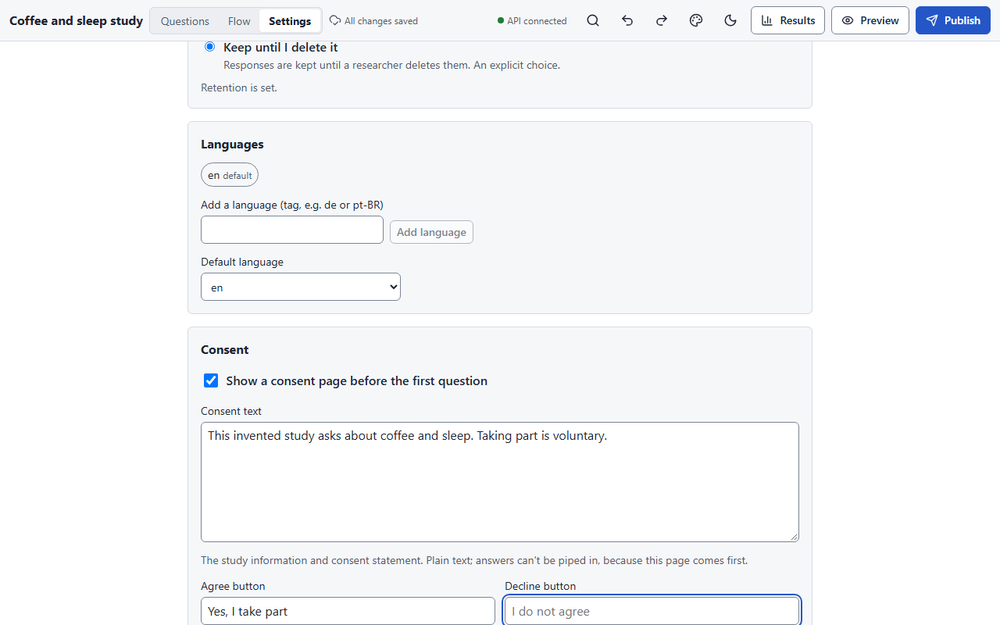

# Settings, consent and languages

**Settings** in the top bar (or **Open survey settings** in the palette) covers how the
survey saves, what participants can do, how long data is kept, consent and endings.

<figure markdown="span">
  { loading=lazy }
</figure>

## Saving responses

| Setting | Options | Notes |
|---|---|---|
| **Saving** | *Save to the server on every page* (default) or *Send nothing until the end* | With every-page saving, drop-outs are visible as partial sessions and a participant can resume on another device. With end-only saving nothing leaves the device before the final submit, so drop-outs are invisible. |
| **Copy kept on the device (end-only)** | *Browser storage* (default) or *Memory only* | Where the end-only copy lives. A memory-only copy is lost on refresh: the session restarts from the first page with the same seed and conditions, and the participant is told. If browser storage is blocked, the app falls back to memory, never to the server. |

Saving never loses an answer that reached the page: a refresh or a closed tab straight after
typing keeps the last answer, even with browser storage blocked.

## Moving through the survey

- **Allow going back** (default on). Going back re-evaluates later pages; an answer that is
  no longer relevant is cleared when the page is submitted.
- **Resume link expires after (days)**, default 30. The private resume link stops working
  after that many days without activity.

## Data retention

A retention policy is **required before you can publish**; there is no default.

| Option | Meaning |
|---|---|
| **Delete a set number of days after the survey closes** | Enter **Days after the survey closes**. |
| **Delete after a date** | Enter **Delete after this date**. |
| **Keep until I delete it** | An explicit "indefinite". |

Press **Save retention**; the status reads *Retention is set.* or *Not set yet: publishing
is blocked until you choose.* The chosen policy goes into the codebook with the data.

## Languages

A survey can carry its text in several languages. Under **Languages**, add a language by its
tag (`de`, `pt-BR`), remove one (the builder asks before deleting its translations), and
choose the **Default language**.

Every text field in the properties panel shows which language you are editing and flags a
**Missing translation**; the diagnostics list them as warnings. Participants get the language
their browser prefers: an exact match, then the same primary language, then the default.
Exports store choice codes, not labels, so the data is the same whatever language a
participant saw; the `_language` column records it, and the codebook has the labels in
every language.

## Consent

Tick **Show a consent page before the first question** to add a consent page. It is
survey-level (shown first, at most once, never inside the flow), with **Consent text**, the
**Agree button** label (default *I agree*) and the **Decline button** label (default *I do
not agree*), each translatable with the **Editing language** selector. A **Preview** shows
what participants will see. Nothing can be piped into consent text.

What the platform guarantees:

- **Before agreement nothing about the participant is saved**, in either save mode: the
  server creates a session with only its seed and assignment, stores no URL parameters, and
  refuses saves and submits until the participant has agreed to exactly this version of the
  text.
- The consent **version** is a hash of the text in every language, so any wording change is
  a new consent version. The response records which version was agreed and when, exported
  as `_consent_version` and `_consented_at`, and the codebook includes the texts.
- **Decline** ends the session with the outcome `declined`: no response and no audit entry
  are recorded, and the session is deleted. Tick **Count declines** to keep an anonymous
  per-publication count.
- **Withdrawal** is available after agreeing, from the end screen or the resume link. It
  deletes the response and the session, and the resume link stops working. The audit entry
  records the reason and how many responses were deleted, never any answer.

A survey without a consent page publishes with a warning, not an error, since consent may
be taken elsewhere.

## Endings

One card per **outcome** the survey can end with: `complete` (the end of the flow, and any
End node left at the default), each End node's outcome, each checked quota's outcome when
full, and the consent decline. **Used by** lists where each comes from. Click **Customise
ending for …** to give an outcome its own screen:

- **Title**: the heading. Empty: *Thank you* in the participant's language.
- **Text**: shown under the heading (after the End node's own message, if it has one).
  Pipe answers and variables with `${id}`; a blank line starts a new paragraph. It is shown
  as plain text, never as HTML. The **Preview** shows pipes as tokens.
- **Show the status line**: the app's own line under the text, *Your answers have been
  sent.*, shown once the response is stored. You can hide it, but you cannot replace it with
  your own wording, so participants are never told something about their data that is not
  true. After a consent decline the line is always *Nothing about you has been recorded*.

**Use the default screen** removes the ending. An ending for an outcome nothing in the
survey reaches is kept, with a warning. Every outcome's screen can be tried in the
**Preview**. In exports, the `complete` ending becomes the XLSForm's final note group and
LimeSurvey's end text, and a quota's ending becomes its LimeSurvey quota message (see the
capability report for the details).

## Whole-survey properties

Select **Whole survey** from the diagnostics strip to edit the survey's **Title**,
**Description**, **Default language**, **Licence**, and the same saving and navigation
settings as above in the properties panel.

## Privacy, by design

- Stored answers, autosaves and URL parameters are encrypted at rest with AES-256-GCM,
  bound to their row, with a keyring that can be rotated.
- No participant endpoint stores or logs an IP address; it is only an in-memory key for
  rate limiting.
- Labs are kept apart: a survey in a lab you have no role in does not exist, as far as the
  API is concerned.
- Audit entries record who did what (publishing, reading results, exports, deletions) and
  never contain participant answers.
